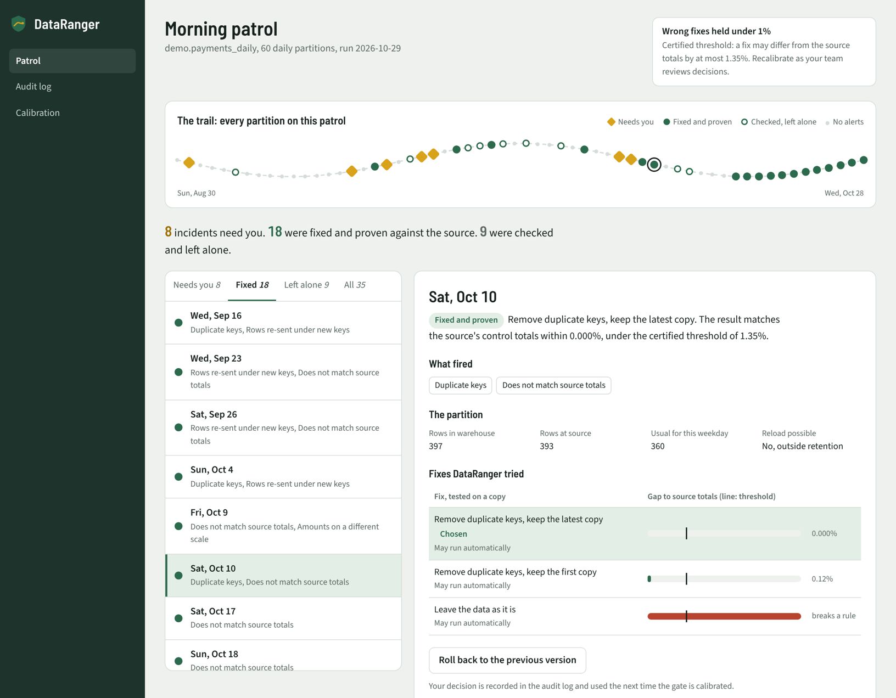
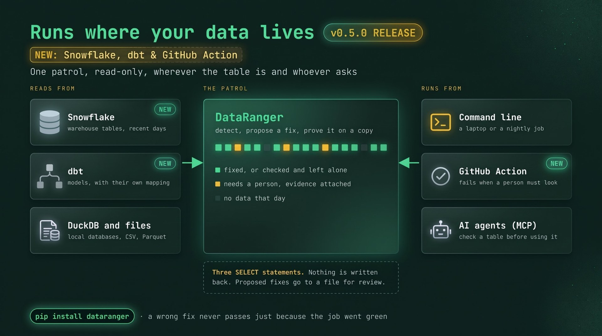

<p align="center">
  
</p>

<!-- mcp-name: io.github.akshaysharma1088/dataranger -->

<h3 align="center">DataRanger patrols your data, fixes what it can prove, and calls you for the rest.</h3>

<p align="center">
A park ranger walks the trails, fixes what is safe to fix on the spot, radios in anything dangerous,
and files a report. DataRanger does the same for your tables. It finds data-quality incidents, tests every
candidate fix on a copy against the source's control totals, applies only the fixes it can prove, and keeps
wrong fixes under a rate you choose. Everything else goes to a person, with the evidence attached.
</p>

<p align="center">
  <a href="https://pypi.org/project/dataranger/"></a>
  <a href="https://pepy.tech/projects/dataranger"></a>
  <a href="LICENSE"></a>
  <a href="https://github.com/akshaysharma1088/dataranger/actions/workflows/ci.yml"></a>
  <a href="https://www.bestpractices.dev/projects/16714"></a>
  <a href="https://doi.org/10.5281/zenodo.23787418"></a>
  
</p>

<p align="center"><sub>The dotted line under the name is a patrol trail: one marker per daily partition, the same marks the patrol console uses.</sub></p>

---

Most data-quality tools stop at an alert. Letting an AI agent fix data is the obvious next step, and a risky one: a wrong fix can pass every monitor you have. In the DQ-Repair benchmark, a rules engine left wrong data behind in 31% of incidents and an agent checked only by monitors in 24%. DataRanger's calibrated gate kept it under 1% while handling 59% of incidents without a person.

## The patrol loop

1. **Detect.** Rules and statistics find nulls, duplicates, schema drift, late partitions, broken references, unit errors and silent shifts. No LLM.
2. **Diagnose.** A language model answers one narrow question: what is the likely cause?
3. **Propose fix.** A templated fix (dedupe, backfill, quarantine, patch). The model fills in parameters only.
4. **Verify.** [pipeverify](https://github.com/akshaysharma1088/pipeverify) checks the fix against source data, on a copy.
5. **Gate.** Proven and low risk: applied as a new version, never an overwrite. Anything else: escalated.
6. **Report.** Every detection, fix and decision lands on a live dashboard and an audit log.

## The patrol console

Every patrol writes one self-contained page that answers a data team's morning question: what broke, what DataRanger fixed, and what needs a person.



- **The trail** across the top shows every daily partition on the patrol. Yellow diamonds need you, solid green markers were fixed and proven against the source, hollow ones were checked and left alone.
- **The queue** lists incidents by what they need from you.
- **The evidence view** shows what fired, the partition next to its source totals, and every fix DataRanger tested on a copy, with its gap to the source against the certified threshold. Above, two copies of re-sent rows disagree: keeping the first copy would leave a 0.12% gap, so DataRanger kept the latest copy, which matches exactly.
- **Decisions** (approve, reject, roll back, reopen) are recorded in the audit log and feed the next calibration.

## Try it

[](https://colab.research.google.com/github/akshaysharma1088/dataranger/blob/main/examples/try_dataranger.ipynb)

Run the [demo notebook](examples/try_dataranger.ipynb) in your browser to see the
summary, audit rows and interactive dashboard without installing anything locally.

```bash
pip install dataranger
dataranger demo                 # patrol a sample table with planted problems; opens as dataranger-demo/dashboard.html
```

On Windows, if `dataranger` is "not recognized" after installing, run it as `python -m dataranger` instead.

On your own DuckDB tables (a fact table partitioned by date, a reference table, and the source's control totals):

```bash
dataranger patrol --db warehouse.duckdb --table payments --ref-table customers \
    --manifest-table control_totals --key payment_id --reference customer_id \
    --date booking_date --segment channel --amount amount
```

Or point it straight at exported files, no database needed (`.csv`, `.tsv` or `.parquet`; the reader follows the extension):

```bash
dataranger patrol --facts-file payments.csv --ref-file customers.csv \
    --manifest-file control_totals.csv --key payment_id --reference customer_id \
    --date booking_date --segment channel --amount amount
```

Use one source at a time. With files, `--table` is optional and only sets the report title (it defaults to the facts file name). Add `--days 45` to any source to patrol only the most recent days.

The control-totals table has one row per date and segment, plus a row with segment `*` for the whole day, with columns `n` (rows) and `amount` (sum). DataRanger never modifies your tables: fixed partitions go to `fixed_version.csv`, every decision and its evidence to `audit.jsonl`, a one-row-per-incident summary for spreadsheets to `incidents.csv`, and the morning report to `dashboard.html`.

If you don't keep a control-totals table yet, build it from the raw or landing table the facts are loaded from, with the same column flags:

```bash
dataranger totals --db warehouse.duckdb --table raw.payments --out-table ops.payments_totals \
    --date booking_date --segment channel --amount amount
dataranger totals --facts-file raw_payments.parquet --out control_totals.csv \
    --date booking_date --segment channel --amount amount
```

`totals` counts each day's rows (a timestamp counts toward its calendar day) and sums the amount, per segment and for the whole day. It stops if a row has no date, or has the segment value `*`. Rows with no segment count only toward the day's `*` row. Running it again replaces the output. `--out-table` is the only way DataRanger writes to your database: it writes only the table you name, replaces an existing table only if that table already has the control-totals columns, and never replaces the `--table` it reads from. The totals are only as independent as the table they come from, so build them upstream of the load you want to check.

For scheduled jobs, add `--json` to either `patrol` command to print one JSON object with
`incidents`, `auto_fixed`, `no_action`, `escalate`, and the `report` path. Add
`--fail-on-escalate` to return exit code 2 when any incident needs review, or 0 otherwise.
The flags work independently: `--fail-on-escalate` also works with the normal text summary.

To hear about escalations without opening the report, add `--notify-webhook URL` (or set
`DATARANGER_WEBHOOK`) with a Slack or Microsoft Teams incoming webhook. When at least one
incident needs a person, the patrol posts `{"text": ...}` with the table, the counts and the
partitions to look at (the same text as `--summary-md`). A Teams webhook made with the
Workflows app (a `logic.azure.com` or `powerplatform.com` URL) gets the same text in an
Adaptive Card instead, which is the shape it expects. A Discord webhook (`discord.com`) gets
`{"content": ...}`, cut at a line break to Discord's 2,000 character limit with a closing line
that says how many partitions were left out. `--notify-always` also posts when
nothing needs a person. A failed post prints a note and leaves the exit code alone, and the
webhook URL is never printed.

To run a daily patrol and download the morning report, copy the
[GitHub Actions example](examples/scheduled/). It runs on demo data without credentials
and includes instructions for your own tables.

The default threshold was calibrated on the DQ-Repair benchmark for a 1% target. Once people have reviewed some of DataRanger's decisions, calibrate on your own data:

```bash
dataranger calibrate --audit report/audit.jsonl --labels reviewed.csv --alpha 0.01
```

`reviewed.csv` has columns `partition` and `verdict` (right or wrong). About 300 reviewed incidents certify a 1% target and about 60 certify 5%.

## What reconciliation can and cannot prove

Checking that a partition's row count and amount match the source's control totals (`n` and `amount`) proves the partition has the right number of rows and the right total value. It does not prove each row is right: two rows can swap values and the count and sum stay exactly the same. For example, if a partition's amounts for two transactions are swapped between rows, `n` and `amount` are unchanged, so an ordinary patrol reports it as clean.

To catch that kind of error, publish extra control measures alongside `n` and `amount` on the control-totals table's whole-day (`*`) row:

- `hash_total`: the sum of a stable hash of each row's key and amount. Additive like `n`/`amount` (so it tolerates the same late-arriving-row noise), but a value swapped between two rows changes it.
- `distinct_<column>`: a distinct count, for example `distinct_customer_id`.
- `min_amount` / `max_amount`: the smallest and largest amount for the day.

DataRanger reads whichever of these columns are present on the manifest and folds them into the same gap-to-source check automatically; a manifest with none of them behaves exactly as before. There's no flag to turn this on at the `patrol`/`totals` CLI level yet — publish the columns and DataRanger picks them up. A second, finer control-totals cut (per channel *and* category, for example) catches a swap between two rows in different categories of the same channel; DataRanger's benchmark can publish this with `category_totals=True`.

## Late-arriving data

A fresh partition can look broken simply because its records haven't all landed yet. Give DataRanger a grace period:

```bash
dataranger patrol --facts-file payments.csv --ref-file customers.csv \
    --manifest-file control_totals.csv --lateness-days 2
```

A partition that is *short* of its control totals and is no more than `--lateness-days` days older than the most recent day in the data is reported as **still open** — neither auto-fixed nor escalated — instead of as an incident. (DataRanger has no load timestamp to measure from, so the window counts back from the most recent day it sees, not from wall-clock time.) The next patrol checks it again: once the data fills in, the "still open" entry disappears on its own; if it's still short once it falls outside the window, it's reported as an ordinary incident. A *surplus* of rows is always reported immediately, inside the window or not, since extra rows are not what late arrivals look like. For a dbt model, set `lateness_days` in the `meta.dataranger` block instead of passing the flag every time.

## Control totals from a flat file's own trailer record

When the source is a flat file, its own trailer line (or a sidecar `.ctl` file) is often stronger evidence than a totals table computed downstream, because the sender wrote it:

```bash
dataranger totals --from-trailer payments_20261101.csv --trailer-date 2026-11-01 \
    --trailer-record-type-field 0 --trailer-record-type-value TRL \
    --trailer-count-field 1 --trailer-amount-field 2 --out control_totals.csv
```

`--trailer-count-field`/`--trailer-amount-field` are 0-based field positions; give `start:end` (for example `3:9`) instead of a plain index to read fixed-width files by character slice rather than by delimiter. Add `--trailer-record-type-field`/`--trailer-record-type-value` when the trailer line is marked (for example a leading `TRL`); without them, the file's (or sidecar's) last non-blank line is read as the trailer. Add `--compare-to computed_totals.csv` to also check the trailer's own numbers against totals computed from the landed rows — a disagreement there is reported as an error and nothing is written, independently of anything `patrol` checks against the warehouse. See [examples/trailers](examples/trailers/) for a worked fixed-width and delimited example.

## Flagging undocumented tables and columns

`patrol` also checks how much of the source is actually documented — column and table descriptions and owners — alongside the data itself:

```bash
dataranger patrol --dbt-model fct_payments            # reads descriptions from the dbt manifest
dataranger patrol --db warehouse.duckdb --table payments --ref-table customers \
    --manifest-table control_totals --date booking_date --segment channel --amount amount
    # reads `comment on table`/`comment on column` from DuckDB, or INFORMATION_SCHEMA comments on Snowflake
```

The summary prints a coverage line ("definitions: 14 of 19 columns") and the dashboard shows the same figure alongside any table missing a description or an owner; `metadata.csv` in the report folder has one row per table. Pass `--skip-metadata-check` to turn this off.

## Escalating an ambiguous tie

Sometimes two different repairs both reconcile perfectly against the source's control totals but leave the table in different states — for example, deduplicating a true duplicate key by keeping the first copy versus the latest, when the two copies agree on amount (so either choice passes every reconciliation check) but disagree on some other column. DataRanger can't tell which is right from the totals alone, so by default it escalates rather than silently picking one; the patrol console shows the competing fixes side by side. Pass `--allow-ambiguous-autofix` to restore the old behavior of picking the smallest change outright.

## How DataRanger compares

DataRanger does not replace your tests or monitoring. It picks up where they stop: at the fix.

| | Tests (dbt tests, Great Expectations, Soda) | Observability platforms (for example Monte Carlo) | AI coding agents | DataRanger |
|---|---|---|---|---|
| Finds problems | Rules you write | Learned patterns and anomalies | When asked | Rules and statistics, against the source's control totals |
| Fixes data | No | No, it alerts and helps find the cause | Yes, without independent proof | Yes, only fixes proven against the source |
| Says how often a fix is wrong | No | No | No | Yes: a wrong-fix rate you choose, with a statistical guarantee |
| When unsure | Fails the run | Sends an alert | Often guesses | Escalates to a person, with the evidence |
| Where it runs | Your pipeline | Vendor service | Your editor or CI | Your machine or CI, open source |

Keep your tests: they catch problems DataRanger is not designed for, such as a new column breaking a
contract. Use DataRanger for the night-shift part, where something has to decide whether a fix is
safe to apply without waking anyone up.

## Where it runs

<p align="center">
  
</p>

DataRanger reads from Snowflake, dbt models, DuckDB and files, and runs from the command line, a GitHub Action or an AI agent. Whatever the source, a patrol is three `SELECT` statements: nothing is written back.

## Snowflake

```bash
pip install "dataranger[snowflake]"
dataranger patrol --snowflake --table ANALYTICS.GOLD.PAYMENTS --ref-table ANALYTICS.GOLD.CUSTOMERS \
    --manifest-table ANALYTICS.OPS.CONTROL_TOTALS --key payment_id --reference customer_id \
    --date booking_date --segment channel --amount amount --days 45
```

DataRanger runs three `SELECT` statements and nothing else, so a read-only role is enough and the warehouse is never modified. It selects only the mapped columns, and `--days` limits both the facts and the control totals, so a patrol costs a few seconds of a small warehouse. Use at least 30 days so the checks have a baseline. Queries carry the query tag `dataranger`, so they are easy to find in query history.

Credentials are read from where you already keep them; DataRanger stores nothing:

- `--snowflake` uses `SNOWFLAKE_ACCOUNT` and `SNOWFLAKE_USER`, with `SNOWFLAKE_PASSWORD`, `SNOWFLAKE_PRIVATE_KEY_PATH` (and `SNOWFLAKE_PRIVATE_KEY_PASSPHRASE`) or `SNOWFLAKE_AUTHENTICATOR`, plus `SNOWFLAKE_ROLE`, `SNOWFLAKE_WAREHOUSE`, `SNOWFLAKE_DATABASE` and `SNOWFLAKE_SCHEMA`. With multi-factor login, set `SNOWFLAKE_AUTHENTICATOR=username_password_mfa` and put the current code from your authenticator app in `SNOWFLAKE_PASSCODE`. For scheduled jobs, use a key pair.
- `--snowflake prod` uses the connection named `prod` in `~/.snowflake/connections.toml`, the file the Snowflake CLI uses.

Column names are matched without regard to case, so `--key payment_id` finds `PAYMENT_ID`. To try it on a trial account with demo data, follow [examples/snowflake](examples/snowflake/).

## dbt

Patrol the table behind a dbt model. DataRanger reads dbt's `target/manifest.json` to find the table and `profiles.yml` to connect (DuckDB, Snowflake and Postgres targets, and BigQuery as experimental), then queries the warehouse itself; it does not run dbt.

Keep the column mapping with the model:

```yaml
models:
  - name: fct_payments
    meta:
      dataranger:
        ref_model: dim_customers
        manifest_model: control_totals
        key: payment_id
        date: paid_on
        segment: channel
        amount: amount
```

```bash
pip install "dataranger[dbt]"        # add the snowflake, postgres or bigquery extra for those targets
dbt build
dataranger patrol --dbt-model fct_payments --days 45
```

When `meta` doesn't set `key`, a `unique` test on one column of the model gives it. When it doesn't set `reference`, a `relationships` test gives the reference column, `ref_model` and `ref_key`. If a model has two such tests, DataRanger doesn't guess: it keeps the default and says which setting to add.

Flags such as `--key` or `--dbt-ref-model` override the `meta` block (and the tests), and `--dbt-target prod` picks another target. There is a complete project you can run without a warehouse in [examples/dbt](examples/dbt/).

The BigQuery target is experimental: so far it has only run against a stand-in client. BigQuery bills by bytes scanned, so use `--days` to keep the scan small; without it a patrol reads the whole table. If the profile sets `maximum_bytes_billed`, every query carries that cap and BigQuery refuses a query that would scan more.

## GitHub Action

Run a patrol in CI, after a load or on a schedule. The action writes the result to the job summary, uploads the report, and fails the job when an incident needs a person.

```yaml
- uses: akshaysharma1088/dataranger@v0.6.0
  with:
    snowflake: "true"
    table: ANALYTICS.GOLD.PAYMENTS
    ref-table: ANALYTICS.GOLD.CUSTOMERS
    manifest-table: ANALYTICS.OPS.CONTROL_TOTALS
    key: payment_id
    date: booking_date
    days: "45"
  env:
    SNOWFLAKE_ACCOUNT: ${{ secrets.SNOWFLAKE_ACCOUNT }}
    SNOWFLAKE_USER: ${{ secrets.SNOWFLAKE_USER }}
    SNOWFLAKE_PASSWORD: ${{ secrets.SNOWFLAKE_PASSWORD }}
    SNOWFLAKE_ROLE: READER
    SNOWFLAKE_WAREHOUSE: XS
```

After `dbt build`, one line is enough when the mapping is in the model's `meta` block:

```yaml
- uses: akshaysharma1088/dataranger@v0.6.0
  with:
    dbt-model: fct_payments
```

The same inputs work for DuckDB (`db`, `table`, `ref-table`, `manifest-table`) and files (`facts-file`, `ref-file`, `manifest-file`). Set `fail-on-escalate: "false"` to report without failing. The outputs `incidents`, `auto-fixed`, `no-action`, `escalate` and `report` are available to later steps. All inputs are listed in [action.yml](action.yml).

## Use it from an AI agent (MCP)

Agents now change pipelines and query data on their own. DataRanger can run as an [MCP](https://modelcontextprotocol.io) server, so an agent can check a table before it trusts it, and hand anything it cannot prove to a person.

With [uv](https://docs.astral.sh/uv/) there is nothing to install first. Claude Code:

```bash
claude mcp add dataranger -- uvx dataranger mcp
```

Claude Desktop, Cursor or VS Code (add to the client's MCP config):

```json
{
  "mcpServers": {
    "dataranger": { "command": "uvx", "args": ["dataranger", "mcp"] }
  }
}
```

Or `pip install dataranger` and use `dataranger mcp` as the command. DataRanger is listed in the [MCP Registry](https://registry.modelcontextprotocol.io) as `io.github.akshaysharma1088/dataranger`.

[](https://glama.ai/mcp/servers/akshaysharma1088/dataranger)

The server exposes six tools:

| Tool | What it does |
|---|---|
| `patrol_duckdb` | Patrol a fact table in a DuckDB file, with your column names |
| `patrol_files` | Patrol exported CSV, TSV or Parquet files |
| `patrol_snowflake` | Patrol a Snowflake table, reading only the last N days |
| `patrol_dbt` | Patrol the table behind a dbt model, using the mapping in its `meta` block |
| `get_incident` | Return the full evidence for one incident from a previous patrol |
| `run_demo` | Patrol generated data with planted problems, to see the output |

Each patrol returns the counts (auto-fixed, no action needed, escalate), the incidents that need a person, and the paths to the dashboard, audit log and proposed fixed version.

The tools are read-only towards your data. Inputs are opened read-only, nothing is written back, and fixes exist only in the proposed fixed version for review. An agent can learn what is wrong and what DataRanger could prove; it cannot change your warehouse through this server.

Try asking your agent: *"Use DataRanger to run the demo and tell me which partitions need a person, and why."*

### Docker

Prebuilt images, one per release, on the [GitHub Container Registry](https://github.com/akshaysharma1088/dataranger/pkgs/container/dataranger):

```bash
docker run --rm -i ghcr.io/akshaysharma1088/dataranger:latest
```

Runs DataRanger as the same MCP server over stdio, for hosts that run tools in a container rather
than a local Python environment. Pin a version instead of `latest` with
`ghcr.io/akshaysharma1088/dataranger:v0.6.2`, and so on for any tagged release.

## What data leaves your machine

None of your data, in normal use.

- **Patrols** run three read-only `SELECT` statements against your warehouse (or read your files),
  do all the work locally, and write the report to a folder you choose. Input tables are never
  modified; fixes are written to a new version.
- **The MCP server** runs on your machine over stdio and exposes read-only tools. Warehouse
  credentials stay in your environment and are never tool arguments.
- **No telemetry.** DataRanger does not report usage anywhere.
- **The dashboard** is a single HTML file. When you open it, your browser fetches two web fonts from
  Google Fonts; no data is sent with that request.
- **Language models are optional** and used only by the benchmark scripts, never by a patrol. They
  call the endpoint you configure, such as a local Ollama server, and receive incident summaries
  (row counts, totals, medians and alert names per day and segment), never raw rows.
- **The real-data benchmarks** download public research datasets the first time you run them.

## DQ-Repair benchmark

DQ-Repair measures how many data-quality issues an agent can fix safely. This branch adds the benchmark data and the detection stage.

**Synthetic cases.** A transactions table and a customer dimension, generated per seed in three sizes (about 24k, 120k and 480k rows over 60 days). Each case keeps the source of record and a dirty warehouse copy with known issues and the correct fix for each:

| Type | What happens | Correct response |
|---|---|---|
| Duplicates | A retried load appends 1 to 8% of a partition again | Dedupe on `txn_id` |
| Late partition | A day's file arrives after the job ran | Reload the partition |
| Schema drift | Upstream renames `channel` to `payment_channel` | Remap, after review |
| Broken references | A bad key mapping points rows at missing customers | Quarantine, escalate |
| Unit or scale | One channel starts sending cents | Rescale by 0.01 |
| Silent drop | A join change quietly drops one slice of a day | Reload the partition |
| Decoys | A promotion day or a big-ticket travel day, real in the source | Do nothing |

**Real datasets.** Hospital, Flights and Beers, the standard cell-level cleaning datasets with known clean versions, downloaded on first use from the [Raha repository](https://github.com/BigDaMa/raha) at a pinned commit.

**Detection so far** (deterministic, no LLM, `results/detection.json`):

- Synthetic, 5 seeds per size: the statistical monitors find every structural error, 60 to 100% of silent drops, and none of the partial-late partitions. Every decoy is flagged too, which is the point: detection cannot tell a real spike from an error, so the later stages must.
- Hospital: F1 0.83. Beers: F1 0.98. Flights: F1 0.10 with no configuration, 0.50 when told the entity key (`flight`).

```bash
pip install -e .
dataranger bench --size small --seed 1        # one synthetic case
python benchmarks/run_detection.py            # all sizes and the real datasets
```

## Repair with a calibrated gate

The loop proposes template fixes for each incident, checks every candidate against the source's control totals and the declared invariants (unique keys, valid references), and applies the best-supported fix only if its residual clears a threshold chosen by Learn-then-Test. Fixes that delete data or change meaning always escalate. The source publishes control totals per partition and channel; 15% of them are stale by up to 1%, so even a correct fix can leave a small residual.

250 instances (150 small, 100 medium), 6,600 incidents, 100 random calibration and test splits by instance, delta = 0.05. Silent harm is the share of incidents that end with a wrong fix applied. All numbers are in `results/repair_summary.json`.

| Policy | Auto-applied | Silent harm | Real errors fixed |
|---|---|---|---|
| Rules: default fix for every alert | 66.6% | 31.1% | 49.3% |
| Agent checked by the monitors | 58.2% | 23.8% | 49.7% |
| Verified, calibrated for alpha = 1% | 58.6% | 0.56% | 56.4% |
| Verified, calibrated for alpha = 2% | 69.4% | 1.42% | 59.0% |
| Verified, calibrated for alpha = 5% | 79.3% | 3.91% | 61.1% |

- **The bound holds.** Test harm exceeded alpha in 1 to 5% of splits, within delta = 5%, for both evidence granularities.
- **Versioned duplicates.** Rules and the monitor-checked agent kept the pre-settlement copy in 500 and 498 of 500 such incidents; the gate picked the settled copy by its match to the control totals.
- **Hand-picked thresholds do not travel.** A threshold of 0.01 is safe with per-channel totals but breaks a 1% target in every split when only partition totals exist; calibration moves the threshold to 0.003 on its own.
- **Exchangeability matters.** Calibrated without any partial-late incidents, the gate then wrongly applies "no action" to 67% of them. New incident types need recalibration, which is what epoch recalibration with repair memory is for.
- **Source-aware detection.** The statistical monitors miss every partial-late partition; a reconciliation check against the control totals catches all of them.

```bash
python benchmarks/run_repair.py 150 100       # about 6 minutes on two cores
python benchmarks/analyze_repair.py
```

### Language models as proposers

Qwen2.5 7B and 14B, served by Ollama on free GitHub Actions runners (`.github/workflows/llm.yml`, triggered by pushing to the `llm-run` branch; responses are committed to `llm-results`), proposed one fix per incident. At a 5% target:

| Model | Policy | Automated | Harm | Real errors fixed |
|---|---|---|---|---|
| 7B | Apply the model's fix | 93.4% | 42.4% | 23.6% |
| 7B | Apply it if the monitors go quiet | 66.5% | 29.4% | 23.3% |
| 7B | Apply it if its own gap to the totals is under 0.5% | 33.6% | 5.58% | 20.8% |
| 7B | Through the gate | 27.2% | 3.19% | 20.4% |
| 7B | Gate over model + templates | 79.3% | 3.17% | 63.4% |
| 14B | Apply the model's fix | 92.8% | 35.5% | 40.1% |
| 14B | Apply it if its own gap to the totals is under 0.5% | 39.5% | 5.22% | 33.8% |
| 14B | Through the gate | 32.3% | 2.43% | 31.9% |

The models' fixes were right for 51% (7B) and 57% (14B) of incidents. An agent that checks its own fix against the control totals is not enough: with a 0.5% tolerance it still breaks a 5% target, while the same tolerance is safe for the pooled candidates. The safe tolerance depends on the proposer, which is what calibration measures. `python benchmarks/eval_llm.py <runs/<id>/llm>` reproduces the table.

### TPC-DS

The same loop on a benchmark we did not design: TPC-DS `store_sales` at scale factor 1 (DuckDB's `dsdgen`), store as the segment for control totals, item category as the category, net paid as the amount. Thirty 60-day windows, three injections each: 4,299 incidents, 58% of them false alarms from TPC-DS's seasonal volume. Splits are by window.

| Policy | Automated | Silent harm | Real errors fixed |
|---|---|---|---|
| Rules: default fix per alert | 82.8% | 63.4% | 44.0% |
| Fix must quiet the monitors | 40.1% | 31.6% | 22.2% |
| Calibrated on TPC-DS, alpha = 1% | 77.6% | 0.59% | 55.8% |
| Calibrated on TPC-DS, alpha = 5% | 90.7% | 3.74% | 61.6% |
| Calibrated on DQ-Repair, applied to TPC-DS, alpha = 1% | 75.8% | 0.47% | 54.9% |

```bash
pip install -e ".[bench]"                      # includes the DuckDB tpcds extension
python benchmarks/run_tpcds.py 1 3             # about 6 minutes on two cores
python benchmarks/analyze_tpcds.py
```

### How strong is the guarantee?

Learn-then-Test assumes independent incidents, and incidents of one table share its manifest. `benchmarks/analyze_guarantee.py` measures it: the intraclass correlation of the loss within an instance is about 0.005 (design effect at most 1.16). `calibrate_clusters` makes the table the unit instead, which needs no independence inside a table; it certifies 5% and 10% targets from 125 tables, and needs about 300 tables for 1%.

### Larger tables

On 40 large instances (about 480k rows each, 1,069 incidents), a threshold calibrated on small and medium tables gave 0.75%, 1.87% and 5.24% harm at targets of 1, 2 and 5%: close to target and just above it at 5%, since relative gaps shrink as partitions grow. Calibrating separately for "no action" decisions and for repairs (`calibrate_groups`) transferred with margin: 0.28%, 1.59% and 4.40%.

### Repair memory under drift

`benchmarks/run_stream.py` simulates a year: five data estates of ten tables each, a new incident type (partial-late partitions) from month 5, and staler control totals from month 9. At a 2% target:

| Policy | Silent harm | Automated | Months over target |
|---|---|---|---|
| Calibrated once | 3.05% | 75.4% | 60% |
| Recalibrated monthly | 1.30% | 62.4% | 18% |
| Monthly + repair memory | 0.39% | 55.0% | 7% (all in month 5) |

Memory (`dataranger.repair.memory`) escalates unfamiliar incident signatures, blocks signatures whose fixes went wrong, and recalibrates on what it would have done. It recovered from the new incident type within a month (harm on partial-late incidents 32% in month 5, 5% in month 6). The price is automation: when the world changes, staying inside the promise means asking people more often.

### Sensitivity and cost

`benchmarks/ablations.py` (results in `results/ablations.json`):

- **Labels needed.** A 5% target is certifiable from about 130 labeled incidents (66% automated); a 1% target needs about 300 before anything is automated, then reaches 50% at about 530 and 59% at 3,300.
- **Stale control totals.** At a 1% target, automation falls from 71% with exact totals to 29% when half of them are stale; harm stays under target.
- **Corrupt control totals** (`run_corrupt.py`, `analyze_corrupt.py`): totals computed downstream of the error agree with the wrong data, so no check against them can see it. Calibrated on the same corrupted source, the gate fails safe (no threshold certified at 1%); calibrated on clean totals and then hit by corruption, the bound breaks like under any drift. Such a source needs a second, independent check.
- **Without invariant checks** the calibration refuses to certify any threshold and automation collapses to about 0%: the gate fails safe.
- **Cost.** A full patrol takes 2.7 s, 4.1 s and 10.1 s on one CPU core for 23k, 117k and 470k-row tables.

### Real datasets: Hospital, Flights, Beers

No source of record here, so the evidence comes from the table itself (agreeing dependencies, normalization rules). Half the rows are labels: a quarter fits an evidence score and a quarter certifies the threshold. Compared on held-out rows with Baran (20 labeled tuples, Raha detection) and conformal data cleaning (reimplemented, trained on clean rows):

| Data | Method | Errors fixed | Precision | Wrong per 1k cells |
|---|---|---|---|---|
| Hospital | Baran | 55.0% | 93.5% | 0.96 |
| Hospital | Conformal cleaning | 85.0% | 64.7% | 11.80 |
| Hospital | DataRanger, alpha 5% | 62.8% | 98.2% | 0.37 |
| Flights | Baran | 51.2% | 81.7% | 34.37 |
| Flights | Conformal cleaning | 51.6% | 94.6% | 8.83 |
| Flights | DataRanger, alpha 5% | 25.0% | 95.3% | 3.67 |
| Beers | Baran | 89.2% | 94.0% | 9.46 |
| Beers | Conformal cleaning | 64.9% | 60.2% | 70.40 |
| Beers | DataRanger, alpha 1% | 85.0% | 100.0% | 0.02 |

The target held in every split. Baran's corrections are in `results/baran/`; `benchmarks/run_baran.py` reproduces them (it needs `pip install raha`).

## Reproducing the paper

```bash
pip install -r environment.txt && pip install -e .   # the exact versions used for the paper
./reproduce.sh          # every analysis from the committed incident records (about 30 minutes, 2 cores)
./reproduce.sh full     # regenerate the records too
```

Seeds are fixed, so the numbers come out the same (wall-clock timings aside). The LLM proposals (from the Actions workflow, saved in `results/llm_responses/`) and Baran's corrections (`results/baran/`, needs `raha`) are scored from their saved outputs, so the archive alone is enough to reproduce every table.

## Contributing

Contributions are welcome. Issues labelled [good first issue](https://github.com/akshaysharma1088/dataranger/labels/good%20first%20issue) are small and come with clear steps; see [CONTRIBUTING.md](CONTRIBUTING.md) to get started.

If DataRanger is useful to you, a ⭐ on the repo helps other people find it.

## Citing

See `CITATION.cff`. Archived on Zenodo: [10.5281/zenodo.23787418](https://doi.org/10.5281/zenodo.23787418).

## License

MIT
